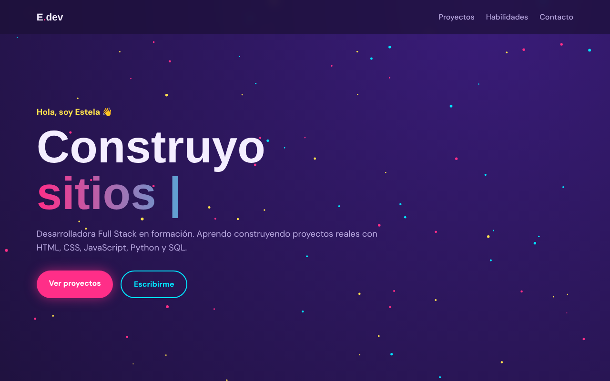
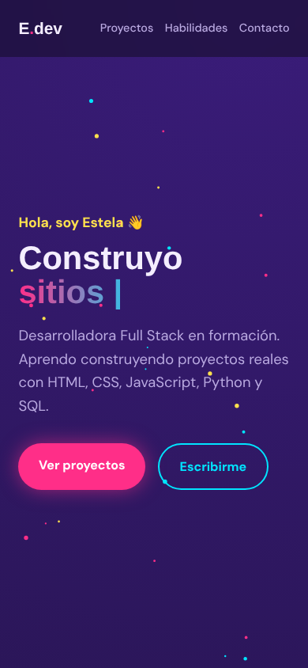

# Portfolio Neón

  

Portfolio personal con estética neón: texto que se escribe solo, partículas que esquivan el mouse, proyectos filtrables y barras de habilidades animadas.

**🔗 Demo en vivo:** https://rumenco1221.github.io/portfolio-neon/



## ✨ Funcionalidades

- Efecto máquina de escribir en el título
- Fondo de partículas en `<canvas>` que reacciona al mouse
- Proyectos generados desde un array y filtrados por categoría
- Barras de habilidades que se llenan al entrar en pantalla (IntersectionObserver)
- Botón para copiar el email al portapapeles (Clipboard API)

## 🛠️ Tecnologías

- HTML5 semántico
- CSS3 (variables, Flexbox, Grid, animaciones, diseño responsive)
- JavaScript moderno (ES6+), sin frameworks ni librerías
- Fuentes de Google Fonts: Unbounded + DM Sans

## 🧠 Lo que practiqué

- Arrays de objetos + `filter` y `map`
- Template literals para generar HTML
- Canvas 2D y `requestAnimationFrame`
- IntersectionObserver
- async/await con `try/catch`
- Variables CSS y `clamp()` para tipografía fluida

## 🎨 Diseño

- **Paleta:** Índigo `#1B1036`, rosa `#FF2E88`, cian `#00E5FF`, amarillo `#FFE14D`
- **Tipografía:** Unbounded + DM Sans
- Responsive desde 360 px, foco visible con teclado y respeto por `prefers-reduced-motion`.



## 📁 Estructura

```
portfolio-neon/
├── index.html
├── assets/
│   ├── css/styles.css
│   └── js/main.js
├── docs/DOCUMENTACION.md
├── images/              # capturas
├── tests/               # pruebas automáticas
└── version_history/CHANGELOG.md
```

## ▶️ Cómo verlo

1. Descargá o cloná el repositorio: `git clone https://github.com/Rumenco1221/portfolio-neon.git`
2. Abrí `index.html` con doble clic, o usá la extensión **Live Server** de VS Code.

## ✅ Pruebas

Con Node.js instalado, desde la carpeta del proyecto:

```bash
node --test tests/test_estructura.mjs
```

Verifica SEO básico, semántica, accesibilidad de imágenes y que existan los archivos CSS y JS.

## 🚀 Próximas mejoras

- [ ] Agregar modo claro
- [ ] Cargar los proyectos desde la API de GitHub
- [ ] Formulario de contacto con Formspree

## 👩‍💻 Autora

**Estela Oviedo Cortez** — Desarrolladora Full Stack en formación.
[LinkedIn](https://www.linkedin.com/in/estela-oviedo-cortez-796303228) · [GitHub](https://github.com/Rumenco1221)

## 📄 Licencia

MIT. Ver [LICENSE](LICENSE).
